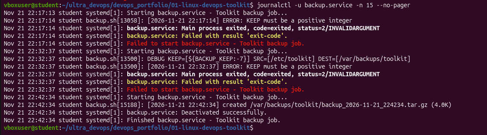

# 01. Linux DevOps Toolkit

Bash, Python and C++ utilities for everyday DevOps tasks on Linux: backups with
rotation, health checks, log cleanup, idempotent user provisioning, log analysis,
SSL expiry checks, system reports and Telegram alerts. Scheduled with systemd timers,
tested with bats, pytest and ctest, verified by CI.

## Why

Routine operations are often done with ad-hoc commands that nobody tests. This toolkit
turns them into documented tools with predictable exit codes, dry-run modes, tests
and automation.

## Tools

| Tool | What it does | Tests |
|---|---|---|
| `scripts/backup.sh` | Timestamped `tar.gz` backups, keep last N, dry-run | bats |
| `scripts/healthcheck.sh` | HTTP, TCP and systemd checks, exit code 0/1 | bats |
| `scripts/log-cleanup.sh` | Delete old logs with safety checks, dry-run | bats |
| `scripts/user-provision.sh` | Users from CSV, groups, sudo, SSH keys, idempotent | bats |
| `scripts/install.sh` | Installs scripts and systemd timers | bats |
| `devtool logs` | nginx log report: top IPs and paths, 4xx/5xx share, JSON | pytest |
| `devtool ssl` | Certificate expiry check, non-zero exit under threshold | pytest |
| `devtool sys` | CPU, memory, disk, top processes | pytest |
| `devtool notify` | Telegram alerts | pytest |
| `logparser` (C++) | Fast log analyzer with output identical to `devtool logs` | ctest |

## Quick start

    git clone git@github.com:svyatkozych/devops_portfolio.git
    cd devops_portfolio/01-linux-devops-toolkit
    python3 -m venv .venv && source .venv/bin/activate
    pip install -e '.[dev]'
    make help
    make test

Try the tools:

    scripts/backup.sh -n -k 3 ~/Documents /tmp/backups     # dry run
    devtool logs tests/data/access.log
    devtool ssl github.com
    devtool sys --top 3
    make lab-up                                             # sandbox for user-provision

## Scheduling with systemd

`sudo scripts/install.sh` installs the scripts to `/opt/toolkit` and enables two timers.

Job output goes to the journal:

Why timers instead of cron: [ADR 0001](docs/adr/0001-systemd-timers-over-cron.md).

## Alerts

`devtool notify` sends Telegram messages, so a failed health check can alert you:

    scripts/healthcheck.sh -u http://localhost:8080 || devtool notify "healthcheck failed on $(hostname)"

## C++ vs Python

Both analyzers print byte-identical reports (`make parity`). Benchmark on a generated log
([details](docs/benchmarks.md), run `make bench` to reproduce):

| Command | Mean [ms] | Min [ms] | Max [ms] | Relative |
|:---|---:|---:|---:|---:|
| `C++ logparser` | 203.0 ± 57.8 | 122.7 | 278.7 | 1.00 |
| `Python devtool` | 2179.0 ± 761.7 | 1470.3 | 3118.5 | 10.73 ± 4.84 |

The C++ parser is also available as a ~1 MB static Docker image:

    docker build -t logparser src/logparser
    docker run --rm -v "$PWD/tests/data:/data:ro" logparser /data/access.log

## Quality

- `shellcheck` on every script, `ruff` on Python code, pre-commit with gitleaks
- bats (Bash), pytest with coverage (Python), ctest and C++/Python parity check (C++)
- GitHub Actions: three jobs (`bash`, `python`, `cpp`), Dependabot for actions, pip and Docker

## Documentation

- [Architecture](docs/architecture.md)
- [Runbook: backup and restore](docs/runbooks/backup-restore.md)
- [Sprint 1 retrospective](docs/retro-sprint1.md), [Sprint 2 retrospective](docs/retro-sprint2.md)
- [Benchmarks](docs/benchmarks.md), [Changelog](CHANGELOG.md)

## What I learned

- Making shell scripts safe: strict mode, dry-run, idempotency, exit-code contracts.
- Testing Bash with bats and testing system-dependent code with mocks and containers.
- Replacing cron with systemd timers (journald logs, `Persistent=true`).
- Verifying a rewrite (Python to C++) with output parity and measuring it with hyperfine.

Back to the [portfolio](../README.md).
